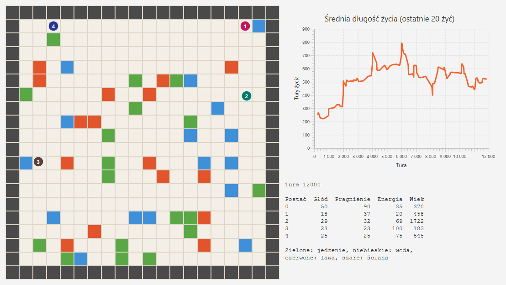
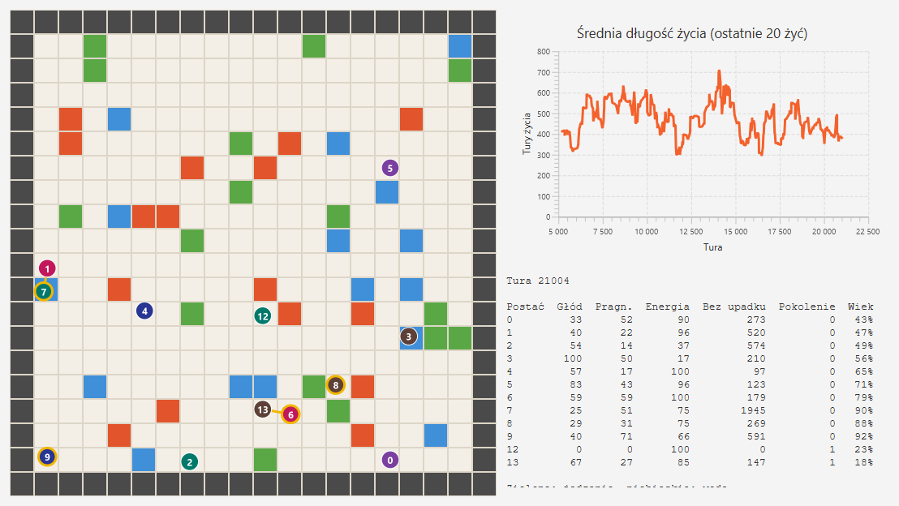

# Roadmapa

Każdy etap kończy się czymś, co widać w oknie albo na wykresie. Etapy 1 i 2 są ukończone, a ich specyfikacje zawierają wyniki odbioru. Etap 3 ma plan z krokami w [docs/stage-3.md](docs/stage-3.md). Etapy 4–6 mają plany wstępne, które doprecyzujemy po wynikach poprzednich.

| Etap | Nazwa | Skala | Status |
|---|---|---|---|
| 1 | Mała osada | 5 postaci, plansza 20×20 | Ukończony |
| 2 | Wspólna wiedza | 12 postaci, kolejne pokolenia | Ukończony |
| 3 | Tworzenie świata | 20–50 postaci, plansza 64×64, pory roku | Następny |
| 4 | Przepisywanie reguł | jak w etapie 3 | Planowany |
| 5 | Relacje między osadami | 3–5 osad | Planowany |
| 6 | Rywalizacja | wiele osad | Planowany |

## Co się uczy i co samo rośnie

Postacie nie dostają gotowych zachowań. W każdym etapie uczą się z własnych doświadczeń, a część algorytmu rozbudowuje się bez naszej ręki.

| Etap | Co się uczy | Co samo rośnie |
|---|---|---|
| 1 | każda postać: które ruchy pozwalają przeżyć | tablica Q o nowe sytuacje; postać sama stroi epsilon i alpha z liczników odwiedzin |
| 2 | osada: wiedza przechodzi na kolejne pokolenia | wspólna mapa odkryć i tablice dziedziczone po starszych; każde pokolenie startuje wyżej |
| 3 | postacie: działania z opóźnioną nagrodą | zestaw akcji złożonych; świat zmieniany przez postacie |
| 4 | osada: które reguły działają | zbiór reguł z historią wersji, poprawiany przez osadę |
| 5 | osady: handel i zaufanie | zwyczaje i specjalizacja każdej osady |
| 6 | osady: strategie przeciw rywalom | liga strategii z kolejnych wersji rywali |

## Etap 1: Mała osada

Pięć postaci uczy się przetrwać, zaczynając od losowych ruchów. Tempo uczenia każda dobiera sobie sama.

- **Świat:** jedzenie (odrasta), woda, lawa i ściany. Głód i pragnienie rosną co turę. Gdy są wysokie albo postać stoi na lawie, spada jej energia. Przy zerowej energii postać umiera i odradza się z tą samą pamięcią. Nagrodę liczy świat.
- **Mózgi:** osobna tablica Q dla każdej postaci. Postać widzi pola 3×3 wokół siebie oraz swój głód i pragnienie. W nowych sytuacjach eksperymentuje, w znanych korzysta z wiedzy, a granicę między nimi wyznacza sama z liczby odwiedzin.
- **Zobaczysz:** najpierw błądzenie i śmierć na lawie, po treningu omijanie lawy, jedzenie i picie przy napotkanych zasobach oraz rosnący wykres długości życia.
- **Gotowe, gdy:** wytrenowane postacie żyją co najmniej 5 razy dłużej niż losowe, samostrojenie nie uczy się wolniej niż stały harmonogram, a ten sam seed daje identyczny przebieg.

Kroki i parametry: [docs/stage-1.md](docs/stage-1.md).

**Wyniki (seed 42, 700 000 tur treningu):**

| Wariant | Średnia długość życia | Względem losowego |
|---|---|---|
| Mózg losowy | 87,5 tury | 1× |
| Stały harmonogram (kontrolny) | 235 tur | 2,7× |
| Samostrojenie | 571 tur | 6,5× |

Samostrojenie przekracza próg 5× w turze 519 000, stały harmonogram nie dochodzi do niego wcale. Dwa przebiegi z tym samym seedem dają identyczny CSV. Wytrenowane postacie stoją na lawie przez 0,05% tur wobec 2,71% u losowych.

Postać widzi tylko sąsiednie pola, więc zasobu szuka wędrówką, a nie marszem z daleka. Szersze pole widzenia albo pamięć miejsc to pierwszy kandydat do etapu 2.

## Etap 2: Wspólna wiedza

Wiedza przeżywa pojedyncze postacie.

- **Świat:** postacie starzeją się i umierają, a na ich miejsce rodzą się nowe z pustą pamięcią. Uczyć się można tylko od sąsiada, więc świat podaje, kto stoi obok kogo.
- **Mózgi:** osada prowadzi wspólną mapę odkryć, z której postać korzysta ruchem „idź do znanego miejsca”. Noworodek startuje od uśrednionej wiedzy starszych i podgląda ich ruchy. Sieć w PyTorchu wchodzi tylko wtedy, gdy tablice Q urosną za bardzo.
- **Gotowe, gdy:** noworodki z wymianą wiedzy dochodzą do poziomu dorosłych co najmniej 2 razy szybciej niż w osadzie kontrolnej bez niej.

Kroki i parametry: [docs/stage-2.md](docs/stage-2.md).

**Wyniki (seed 42, 12 postaci, 400 000 tur):** średnia długość życia dorosłych w kolejnych pokoleniach, przy poziomie dorosłych równym 434 tury.

| Osada | Założyciele | Pok. 1 | Pok. 2 | Pok. 3 | Pok. 4 |
|---|---|---|---|---|---|
| Kontrolna (bez wymiany) | 151 | 142 | 141 | 140 | 140 |
| Z wymianą wiedzy | 210 | 388 | 435 | 518 | 459 |

W osadzie z wymianą wiedzy każde pokolenie startuje wyżej od poprzedniego. Połowa noworodków dochodzi do poziomu dorosłych po 18 500 turach życia w pokoleniu 1 i po 4900 w pokoleniu 4. W osadzie kontrolnej nie dochodzi do niego żaden. W przebiegu wydłużonym do 600 000 tur poziom trzyma się przez siedem pokoleń.

Tablice Q pozostały małe (około 2700 sytuacji na postać), więc sieć w PyTorchu nie była potrzebna i wchodzi dopiero w etapie 3. Podglądanie ruchów sąsiada nie dało mierzalnego efektu; wiedzę niosą dziedziczenie i mapa.

## Etap 3: Tworzenie świata

Postacie zmieniają świat, żeby przetrwać trudniejsze warunki.

- **Świat:** pory roku, a zimą nic nie rośnie. Postacie zbierają drewno, sadzą, budują schronienia i magazyny, noszą przedmioty. Historia świata trafia do PostgreSQL (Spring Boot, Flyway), a stan świata zapiszesz i wczytasz jak zapis gry.
- **Mózgi:** nagroda przychodzi z opóźnieniem (sadzisz wiosną, jesz jesienią), więc wchodzi PyTorch z PPO i akcje złożone typu „idź po drewno”.
- **Gotowe, gdy:** osada przeżywa zimę dzięki polom i zapasom, a jej wersja bez budowania wymiera.

Plan z krokami: [docs/stage-3.md](docs/stage-3.md). Najważniejsze ustalenia planu: śmierć staje się ostateczna, osada ma jedną sieć zamiast tablicy na postać, a przed uczeniem osada ze scenariusza napisanego ręcznie dowodzi, że zimę da się przeżyć.

## Etap 4: Przepisywanie reguł

Osada sama poprawia swoje zasady i zostawia tylko te, które działają. Tu wraca pomysł samonadpisującego się algorytmu.

- **Reguły jako dane:** JSON z historią wersji, np. „dziel się jedzeniem z głodnym” albo „30% plonów do magazynu”.
- **Propozycje:** najpierw losowe mutacje, potem model językowy z LM Studio, który czyta kronikę osady i uzasadnia zmianę. Lokalny model odpowiada wolno, więc proponuje raz na sezon.
- **Sędzia w Javie:** świat kopiuje bieżący stan, puszcza starą i nową regułę przez kilka sezonów i zostawia lepszą. Reguły nie mają dostępu do fizyki świata ani punktacji.
- **Gotowe, gdy:** osada na poprawionych regułach radzi sobie lepiej niż na startowych, a próba zmiany punktacji kończy się odrzuceniem.

Plan wstępny: [docs/stage-4.md](docs/stage-4.md).

## Etap 5: Relacje między osadami

Kilka osad z własną kulturą spotyka się, handluje i buduje zaufanie.

- **Świat:** zasoby rozłożone nierówno, więc handel się opłaca. Świat wykonuje umowy i zapisuje zaufanie między osadami jako graf.
- **Mózgi:** każda osada trenuje własną sieć i wykształca własne zwyczaje. Przywódcy negocjują przez model językowy i pamiętają wcześniejsze spotkania.
- **Widok:** Unity 6 jako widok 3D, podpięty do tego samego świata.
- **Gotowe, gdy:** osady same handlują i się specjalizują, a zaufanie rośnie po dotrzymanych umowach i spada po zerwanych.

Plan wstępny: [docs/stage-5.md](docs/stage-5.md).

## Etap 6: Rywalizacja

Osady walczą o kurczące się zasoby i teren, zawierają sojusze i je zrywają.

- **Świat:** wyczerpujące się złoża, susze, granice terytoriów, napady, obrona i migracje. Konflikty rozstrzyga świat według stałych zasad.
- **Mózgi:** osady trenują przeciwko sobie i starszym wersjom rywali (self-play z ligą), żeby nie krążyły w kółko między tymi samymi strategiami. Sojusze i pokój negocjują przywódcy.
- **Obliczenia:** tu trening na CPU zwolni. Wtedy zmniejszamy sieci albo wynajmujemy GPU w chmurze na czas treningu.
- **Gotowe, gdy:** sojusze i konflikty powstają bez zaprogramowanych scenariuszy.

Plan wstępny: [docs/stage-6.md](docs/stage-6.md).

## Co łączy pozostałe etapy

Plany etapów 3–6 opierają się na tym, co zmierzyliśmy w etapach 1 i 2:

- **Umiejętności zamiast cech stanu.** Postać dostaje gotowe umiejętności złożone, a uczenie wybiera, której użyć. Sam kierunek do wody w stanie Q nie zadziałał, gotowy ruch „idź do znanego miejsca” zadziałał od razu.
- **Najpierw dowód, że się da.** Zanim cokolwiek uczymy, scenariusz napisany ręcznie pokazuje, że kryterium etapu jest osiągalne w tym świecie. Ten sam scenariusz stroi parametry.
- **Pomiar tempa przed uczeniem.** Każdy etap ma krok, który mierzy tury na sekundę, zanim zaplanujemy długość przebiegów.
- **Osada kontrolna w każdym odbiorze.** Efekt liczymy względem tej samej osady bez badanego mechanizmu.
- **Zgodność wstecz.** Każdy etap kończy się sprawdzeniem, że wcześniejsze dają wyniki identyczne ze swoimi odbiorami.
- **Negatywny wynik też jest wynikiem.** Gdy coś nie działa, zapisujemy to z liczbami i zmieniamy podejście, zamiast stroić parametry po cichu.

Największe ryzyko całej reszty siedzi w etapie 3: uczenie z opóźnioną nagrodą. Etapy 4–6 budują na osadzie, która umie przeżyć zimę, więc ich plany zależą od tego, jak wyjdzie etap 3.

## Dalej

Gospodarkę z walutą, władzę z prawami uchwalanymi głosowaniem, rodziny i wynalazki dokładamy jako osobne moduły świata, każdy z własnymi wiadomościami w kontrakcie. Kolejność ustalimy po etapie 6, patrząc na to, co samo wyrosło w symulacji.
