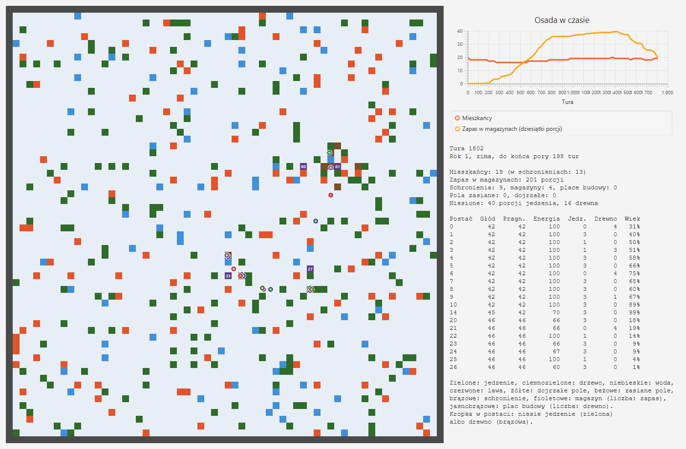

# Etap 3: Tworzenie świata

Status: ukończony. Wszystkie kroki są gotowe, a odbiór (3.13) jest w sekcji „Odbiór”. Wytrenowana osada przeżywa pięć zim i kończy z 23 postaciami.

## Cel

Postacie zmieniają świat, żeby przetrwać trudniejsze warunki. Dochodzą pory roku: zimą nic nie rośnie, więc osada, która nie sadzi, nie gromadzi zapasów i nie buduje, wymiera. Na końcu porównujemy osadę, która może budować, z tą samą osadą bez tej możliwości.

Etapy 1 i 2 zostają uruchamialne na swoich plikach konfiguracji i dają te same wyniki co w swoich odbiorach.

## Co wynika z etapów 1 i 2

Plan opiera się na czterech rzeczach, które zmierzyliśmy:

- **Tablica nie uogólnia.** Kierunek do wody w stanie Q nie zadziałał w żadnej z trzech wersji. Zadziałał dopiero gotowy ruch „idź do znanego miejsca”. Dlatego etap 3 od początku daje postaciom umiejętności złożone, a uczenie wybiera, której użyć.
- **Nauka jest wolna.** Jedna postać potrzebowała ponad 500 000 tur, żeby dojść do poziomu dorosłych. Opóźniona nagroda (sadzisz wiosną, jesz jesienią) jest dużo trudniejsza, więc najpierw sprawdzamy scenariuszem, że świat da się przeżyć, a dopiero potem uczymy.
- **Wiedzę niosą dziedziczenie i mapa.** Podglądanie sąsiadów nie dało mierzalnego efektu. W etapie 3 wiedzę osady trzyma jedna sieć, a mapa zostaje pamięcią postaci.
- **Tempo to około 800–2000 tur na sekundę przy 5–12 postaciach.** Przy 50 postaciach i sieci neuronowej spadnie kilka razy. Pomiar tempa jest osobnym krokiem przed uczeniem.

## Świat (`world-core`)

Zasady etapów 1 i 2 obowiązują dalej. Każda nowa zasada ma przełącznik albo parametr w konfiguracji, a jego wartość domyślna odtwarza zachowanie etapów 1 i 2.

- **Plansza 64×64.** Typy pól z etapu 1 plus drzewo, pniak, pole zasiane, pole dojrzałe, plac budowy schronienia, plac budowy magazynu, schronienie i magazyn. Po każdym polu poza ścianą i lawą da się chodzić.
- **Pory roku.** Rok ma cztery pory o równej długości: wiosnę, lato, jesień i zimę. Odrastanie jedzenia, drzew i pól liczy punkty wzrostu: wiosną i latem pełne, jesienią połowa, zimą zero. Pierwszego dnia zimy dzikie jedzenie i niezebrane dojrzałe pola marnieją, a dzikie jedzenie odrasta dopiero wiosną. Zimą postać poza schronieniem traci energię z zimna.
- **Energia wraca.** W turze bez żadnej straty postać odzyskuje trochę energii. Bez tego każda postać prędzej czy później by umarła, bo śmierć jest teraz ostateczna.
- **Przedmioty.** Postać nosi najwyżej 4 przedmioty: porcje jedzenia i drewno. Zbiera je ruchem „zbierz” z dzikiego jedzenia, z dojrzałego pola i z drzewa. Ścięte drzewo zostawia pniak, który z czasem odrasta. Niesione jedzenie zjada osobnym ruchem. Ruch „jedz” działa też wprost na dojrzałym polu i na magazynie (jedna porcja), więc postać z rękami pełnymi drewna nie głoduje obok jedzenia.
- **Sadzenie.** Postać sadzi niesioną porcję jedzenia na pustym polu. Pole dojrzewa po określonej liczbie punktów wzrostu i daje kilka porcji, które zbiera się po jednej. Sadzisz jedną porcję, zbierasz cztery. Specyfikacja wstępna mówiła o nasionach; porcja jedzenia w roli nasiona daje ten sam wybór (zjeść teraz albo zasiać) bez dodatkowego przedmiotu.
- **Budowanie.** Postać zakłada plac budowy na pustym polu, a potem przynosi na niego drewno i pracuje. Każde drewno i każda tura pracy to jeden ruch „buduj”, więc kilka postaci może budować razem. Schronienie chroni przed zimnem do 4 postaci, które na nim stoją. Magazyn przyjmuje niesione jedzenie i wydaje je po jednej porcji. Jedzenie w magazynie się nie psuje.
- **Śmierć i narodziny.** Upadek z głodu, pragnienia, zimna albo lawy oznacza śmierć na stałe, tak jak starość. Noworodek rodzi się przy magazynie, gdy w magazynach leży nadwyżka jedzenia ponad zapas na każdego mieszkańca, w schronieniach są wolne miejsca, a od poprzednich narodzin minął ustalony czas. Narodziny kosztują porcje z magazynu. Osada może więc rosnąć, kurczyć się i wymrzeć.
- **Założyciele** startują blisko siebie, w promieniu kilku pól od losowego miejsca na planszy.
- **Nagroda.** Liczy ją świat, jak dotąd. Dochodzi premia dla każdej postaci, która przeżyła zimę. Nagrody za samo sadzenie, magazynowanie i budowanie nie ma: ich wartość postać ma odkryć przez opóźniony skutek. Specyfikacja wstępna przewidywała plus za odłożenie jedzenia do magazynu; usunąłem go, bo kłócił się z kryterium „osada magazynuje, choć świat tego nie nagradza”.
- **Limit życia z etapu 1** (ucięcie epizodu po 2000 turach bez upadku) jest wyłączony, bo przenosiłby postać w losowe miejsce.

## Mózgi (`brain`)

- **Sieć zamiast tablic.** Jedna mała sieć na osadę w PyTorchu, trenowana PPO. Wszystkie postacie osady korzystają z tej samej sieci i każda dokłada do niej swoje doświadczenia. To odpowiednik dziedziczenia z etapu 2: noworodek od razu ma wiedzę osady.
- **Obserwacja dla sieci.** Wycinek planszy wokół postaci (większy niż 3×3), potrzeby, ekwipunek, pora roku i tura w roku, wiek oraz cechy z mapy odkryć: odległość i kierunek do najbliższego znanego miejsca każdego typu.
- **Umiejętności złożone.** Sieć wybiera umiejętność, a mózg zamienia ją na pojedyncze ruchy kontraktu, tak jak „idź do znanego miejsca” w etapie 2. Zestaw z kroku 3.10 ma jedenaście umiejętności: pij, jedz, zbieraj jedzenie, zbieraj drewno, zanieś do magazynu, weź z magazynu, zasadź, buduj schronienie, buduj magazyn, schroń się, odkrywaj. Postać trzyma się wybranej umiejętności przez 8 tur, chyba że wcześniej przestanie ona być możliwa.
- **Mapa odkryć** zostaje pamięcią pojedynczej postaci i wymienia się przy kontakcie, jak w etapie 2. Obejmuje nowe typy miejsc.
- **Tablice Q** zostają w kodzie dla etapów 1 i 2.

## Historia i zapis (`world-history`)

Nowy moduł ze Spring Bootem, PostgreSQL i Flywayem. `world-core` dalej nie wie o bazie.

- **Kronika.** Zdarzenia świata (narodziny, śmierci, budowy, zbiory, zmiany pór roku) trafiają do bazy przez słuchacza zdarzeń. Zapis nie spowalnia tury: idzie partiami w tle.
- **Zapis i wczytanie stanu.** Cały stan świata zapisujesz i wczytujesz jak zapis gry. Wczytany świat daje dalej ten sam przebieg co oryginał.
- **Baza lokalnie.** PostgreSQL uruchamiany przez Docker Compose, testy na Testcontainers.

## Kontrakt

Same nowe pola i wartości, stare numery bez zmian:

- `Cell`: drzewo, pniak, pole zasiane, pole dojrzałe, plac budowy schronienia, plac budowy magazynu, schronienie, magazyn.
- `Action`: zbierz, zjedz niesione, zasiej, buduj schronienie, buduj magazyn, odłóż do magazynu, weź z magazynu.
- `Observation`: bok wycinka planszy (3 w etapach 1 i 2, 7 w etapie 3), niesione jedzenie i drewno, pora roku, liczba tur do jej końca oraz to, co leży na polu pod postacią (porcje na dojrzałym polu, jedzenie w magazynie, drewno na placu budowy).
- `StepRequest`: identyfikator osady (jedna osada w etapie 3, wiele od etapu 5).

## Parametry startowe

Wartości do strojenia w `config/stage-3.yaml`. Krok 3.6 ustala je tak, żeby świat dało się przeżyć z budowaniem i nie dało bez niego.

| Parametr | Wartość |
|---|---|
| Plansza | 64×64 razem ze ścianą |
| Postacie na starcie / limit | 20 / 50 |
| Założyciele | w promieniu 4 pól od losowego miejsca |
| Udział pól jedzenia / wody / lawy / drzew | 6% / 2% / 3% / 5% |
| Odrastanie dzikiego jedzenia / drzew | 60 / 300 tur pełnego wzrostu |
| Długość pory roku | 500 tur (rok 2000) |
| Wzrost wiosną / latem / jesienią / zimą | 100% / 100% / 50% / 0% |
| Zimno zimą | −1 energii na turę poza schronieniem |
| Odzyskiwanie energii | +1 na turę bez strat |
| Ekwipunek | 4 przedmioty |
| Dojrzewanie pola | 300 tur pełnego wzrostu, plon 4 porcje |
| Schronienie | 6 drewna, 30 tur pracy, 4 miejsca |
| Magazyn | 4 drewna, 20 tur pracy, 100 porcji |
| Narodziny | 10 porcji z magazynu, zapas 5 porcji na mieszkańca, co najmniej 200 tur odstępu |
| Wycinek planszy w obserwacji | 7×7 |
| Długość życia | 3 lata (6000 tur) ± 20% |
| Premia za przeżytą zimę | +5 |
| Seed | 42 |

Pora roku jest krótsza niż w specyfikacji wstępnej (500 zamiast 1000 tur), bo zimowy zapas rośnie z długością zimy: przy 1000 turach osada 20 postaci potrzebowałaby kilkuset porcji w magazynach.

## Kroki

- [x] **3.1 Specyfikacja i kontrakt.** Doprecyzowanie tego dokumentu, `config/stage-3.yaml`, nowe pola i wartości w `proto/brain.proto`, wartości domyślne dla plików etapów 1 i 2.

  *Gotowe, gdy:* build i testy przechodzą, a etapy 1 i 2 dają pliki identyczne ze swoimi odbiorami.

- [x] **3.2 Pory roku i zimno.** Zegar roku, odrastanie zależne od pory, utrata energii z zimna.

  *Gotowe, gdy:* każda zasada ma test, a rok przebiega powtarzalnie na tym samym seedzie.

- [x] **3.3 Przedmioty i drzewa.** Ekwipunek, zbieranie drewna, noszenie jedzenia, odkładanie i podnoszenie.

  *Gotowe, gdy:* każda zasada ma test, w tym limit ekwipunku i to, że przedmioty nie znikają ani się nie mnożą.

- [x] **3.4 Sadzenie i pola.** Nasiona, zasiew, dojrzewanie, zbiór.

  *Gotowe, gdy:* testy pokrywają cały cykl pola, także zasiew tuż przed zimą.

- [x] **3.5 Budowanie i magazyn.** Schronienie, magazyn, praca rozłożona na tury i na kilka postaci.

  *Gotowe, gdy:* testy sprawdzają koszt, czas budowy, pojemność i ochronę przed zimnem.

- [x] **3.6 Śmierć, narodziny i osada ze scenariusza.** Ostateczna śmierć, narodziny z nadwyżki, mózg ze scenariuszem napisanym ręcznie (zbieraj, sadź, buduj, magazynuj) i ten sam scenariusz bez budowania.

  *Gotowe, gdy:* osada ze scenariuszem przeżywa 5 zim, a wersja bez budowania wymiera przed końcem drugiej zimy. Ten krok stroi parametry świata.

- [x] **3.7 Skala i tempo.** Plansza 64×64, do 50 postaci, pomiar tur na sekundę ze scenariuszem i z pustą siecią, profilowanie transportu i świata.

  *Gotowe, gdy:* znamy tempo i wiemy, ile trwa rok symulacji. Jeśli rok trwa dłużej niż 20 sekund, krok kończy się planem przyspieszenia (większe paczki, kilka światów naraz), zanim ruszy uczenie.

- [x] **3.8 Kronika i zapis stanu.** Moduł `world-history`, schemat Flyway, zapis zdarzeń w tle, zapis i wczytanie stanu świata.

  *Gotowe, gdy:* wczytany zapis daje dalej ten sam przebieg co oryginał, a kronikę da się odpytać o historię jednej postaci i jednego roku.

- [x] **3.9 Sieć na świecie etapu 2.** PyTorch, PPO, jedna sieć na osadę, uczenie na świecie etapu 2 bez nowych zasad.

  *Gotowe, gdy:* osada z siecią dochodzi do poziomu dorosłych z etapu 2 (434 tury między upadkami). Ten krok sprawdza sieć na zadaniu, które już umiemy zmierzyć.

- [x] **3.10 Umiejętności złożone.** Zestaw umiejętności, ich zamiana na ruchy, wybór umiejętności przez sieć, mapa z nowymi typami miejsc.

  *Gotowe, gdy:* każda umiejętność ma test, a postać ze scenariuszem zbudowanym z samych umiejętności przeżywa zimę.

- [x] **3.11 Uczenie z opóźnioną nagrodą.** PPO na pełnym świecie etapu 3, najpierw na krótszych porach roku, potem na docelowych.

  *Gotowe, gdy:* krzywa uczenia pokazuje, że osada zaczyna sadzić i magazynować bez nagrody za te czynności.

- [x] **3.12 Widok.** Pory roku, budowle, ekwipunek, liczba mieszkańców, zapas w magazynie, wczytanie zapisu.

  *Gotowe, gdy:* w oknie widać cykl roku: zbiory jesienią, schronienia zimą, zasiewy wiosną.

- [x] **3.13 Odbiór etapu.** Sprawdź kryteria i wpisz wyniki do `ROADMAP.md`.

## Wyniki kroków

### 3.6 Osada ze scenariusza

Seed 42, plansza 64×64, 20 założycieli, pięć lat (10 000 tur). Scenariusz napisany ręcznie łączy to, co widzą wszystkie postacie, w jedną pamięć osady: wybiera dom przy wodzie, planuje magazyny pod zimowy zapas i schronienia pod liczbę mieszkańców, a role dzieli na budowniczych (co trzecia postać, gdy jest plac budowy) i zbieraczy. Zimą wszyscy stoją w schronieniach i jedzą z magazynów.

| Zima | Postacie przed zimą | Po zimie | Jedzenie w magazynach | Schronienia | Magazyny |
|---|---|---|---|---|---|
| 1 | 21 | 19 | 354 | 8 | 4 |
| 2 | 23 | 23 | 317 | 9 | 4 |
| 3 | 23 | 24 | 325 | 9 | 4 |
| 4 | 25 | 25 | 295 | 9 | 5 |
| 5 | 21 | 20 | 358 | 9 | 5 |

- **Z budowaniem osada przeżywa pięć zim:** po każdej zimie żyje ponad połowa, a po pięciu latach 20 postaci, tyle samo co na starcie. Przez pięć lat z innych przyczyn niż starość zginęły 4 postacie.
- **Bez budowania osada wymiera w 1600. turze,** 100 tur po początku pierwszej zimy: zimno zabiera energię szybciej, niż wraca, a jedzenia nie ma gdzie przechować.
- **Zapas jest niewielki.** 20 postaci po pięciu latach to dokładnie próg kryterium. Wynik pochodzi z jednego seeda.

Strojenie świata w tym kroku:

- **Dzikiego jedzenia było za mało.** Przy 3% pól i odrastaniu po 100 turach osada znała zwykle 2–13 miejsc z jedzeniem i postacie umierały z głodu już wiosną. Teraz 6% pól i 60 tur.
- **Odstęp między narodzinami spadł z 250 do 200 tur,** żeby narodziny nadążały za śmiercią ze starości (założyciele mają wiek rozłożony na całą długość życia, więc w pierwszych latach umiera ich około sześciu rocznie).
- **„Jedz” na polu i magazynie.** Budowniczy z czterema drewnami nie mógł wziąć porcji z magazynu i umierał z głodu obok jedzenia.

Lekcje dla uczenia w kroku 3.11, wyciągnięte z poprawek scenariusza:

- Zimą marnieje jedzenie, którego nikt nie widzi. Pamięć, która tego nie uwzględnia, prowadzi wiosną do pustych krzaków.
- Głodna postać musi iść do jedzenia pewnego (widzianego albo w magazynie). Krzaki „na próbę” zabijały postacie przy pełnych magazynach.
- Drewna nie da się odłożyć. Kto je niesie bez placu budowy, ma ręce zajęte na zawsze.

### 3.7 Skala i tempo

Plansza 64×64, 4000 tur na pomiar, jeden wątek po stronie mózgów. Losowe ruchy i pusta sieć zabijają osadę w kilkaset tur, więc te wiersze liczą świat ze stałą populacją (bez ostatecznej śmierci, starości i narodzin). Osada ze scenariusza działa na prawdziwych zasadach.

| Postacie | Mózg | Tur/s | Rok (s) | ms/turę | W tym mózg (ms) |
|---|---|---|---|---|---|
| 20 | sam świat, ruchy w procesie Javy | 22 013 | 0,1 | 0,05 | – |
| 20 | losowy przez gRPC | 799 | 2,5 | 1,25 | 0,07 |
| 20 | scenariusz | 102 | 19,6 | 9,80 | 8,26 |
| 20 | pusta sieć (MLP, PyTorch) | 499 | 4,0 | 2,00 | 0,75 |
| 50 | sam świat, ruchy w procesie Javy | 15 195 | 0,1 | 0,07 | – |
| 50 | losowy przez gRPC | 739 | 2,7 | 1,35 | 0,12 |
| 50 | scenariusz | 82 | 24,4 | 12,20 | 10,52 |
| 50 | pusta sieć (MLP, PyTorch) | 367 | 5,4 | 2,72 | 1,25 |

- **Świat nie jest wąskim gardłem.** Bez gRPC liczy 15–22 tysiące tur na sekundę.
- **Większość czasu tury zjada transport.** Wywołanie gRPC z kodowaniem wiadomości kosztuje około 1,2 ms na turę, kilkanaście razy więcej niż sam świat.
- **Rok z siecią trwa 4–5,4 s,** poniżej progu 20 s. Plan przyspieszenia przed uczeniem nie jest potrzebny.
- **Scenariusz jest wolny (20–24 s na rok)** przez przeszukiwanie mapy w Pythonie co turę. Służy tylko jako dowód, więc go nie przyspieszam.

Gdyby uczenie w kroku 3.11 potrzebowało więcej lat symulacji, pierwszym krokiem jest kilka światów w jednym zapytaniu `Step`: koszt transportu rozłoży się na kilka osad, a świat ma zapas kilkunastokrotny.

### 3.8 Kronika i zapis stanu

- **Zapis stanu.** `World.exportState()` zwraca pełny stan świata jako zwykły rekord (`WorldState`): planszę z licznikami wzrostu, postacie, zmarłych czekających na ostatni widok i stan generatora losowego. `World.restore` buduje z niego świat, który dalej liczy dokładnie tak samo. Sprawdzają to testy w `world-core` (700 tur z narodzinami, zgonami i zimami) i w `world-history` (zapis przez bazę i powrót).
- **Kronika.** Zdarzenia świata (zgony, narodziny, starość, pory roku, siew, zbiory, budowy) trafiają do tabeli `event` partiami w osobnym wątku. Zapis stanu trafia do `world_save` jako JSON.
- **Pytania do kroniki.** `npc --run R --npc N` wypisuje historię jednej postaci, `year --run R --year Y` liczy, co wydarzyło się w roku. W próbie na scenariuszu rok 0 miał 8 narodzin, 9 śmierci ze starości, 9 zasiewów, 8 schronień i 4 magazyny.
- **Wczytanie zapisu działa jak w grze.** `resume --save ID` kasuje z kroniki wszystko, co przebieg zapisał po turze zapisu, i liczy dalej od niej.
- **Mózgi zapisują się same.** Zapis obejmuje świat, a nie pamięć mózgów. Wczytany świat z tymi samymi decyzjami daje ten sam przebieg; scenariusz z kroku 3.6 trzyma pamięć w procesie serwera, więc po wznowieniu decyduje trochę inaczej (w próbie 19 postaci zamiast 21 po 500 turach).

### 3.9 Sieć na świecie etapu 2

Seed 42, świat z `config/stage-2.yaml` bez zmian, 400 000 tur, jedna sieć na 12 postaci. Sieć wybiera spośród tych samych siedmiu ruchów co mózg z tablicą Q (sześć ruchów kontraktu i „idź do znanego miejsca”), a na wejściu dostaje pola 3×3, potrzeby i kierunki z mapy miejsc.

| Osada | Założyciele | Pok. 1 | Pok. 2 | Pok. 3 | Pok. 4 |
|---|---|---|---|---|---|
| Tablice Q z wymianą wiedzy (etap 2) | 210 | 388 | 435 | 518 | 459 |
| Jedna sieć z PPO | 1392 | 1994 | 1993 | 2000 | 2000 |

Liczby to średnia długość życia dorosłych w turach, przy poziomie dorosłych 434 i limicie epizodu 2000.

- **Sieć przekracza poziom dorosłych wielokrotnie.** Od pierwszego pokolenia prawie każdy epizod dorosłego kończy się na limicie 2000 tur, a nie upadkiem.
- **Noworodek nie zaczyna od zera.** Korzysta z tej samej sieci co reszta osady, więc już pierwsze pięć epizodów noworodka ma średnią powyżej poziomu dorosłych. Miara z etapu 2 pokazuje to jako 10 000 tur życia, bo epizod trwa tu 2000 tur i szybciej zmierzyć się tego nie da.
- **Tempo: 388 tur na sekundę** razem z uczeniem, czyli 400 000 tur w około 17 minut.
- **Powtarzalność:** dwa przebiegi z tym samym seedem dały identyczne pliki statystyk i dzienniki epizodów (`s2-network` i `s2-network-repeat`).
- **PyTorch 2.15 ma paczkę dla Pythona 3.14,** więc mózgi zostają na 3.14.

### 3.10 Umiejętności złożone

Każda z jedenastu umiejętności ma test zamiany na ruch i test maski (`brain/tests/test_skills.py`). Dowodem, że zestaw wystarcza, jest scenariusz zbudowany z samych umiejętności (`--variant skills-scripted`). Każda postać decyduje w nim sama, z własnej obserwacji i własnej mapy miejsc, bez wspólnej pamięci osady z kroku 3.6.

Seed 42, plansza 64×64, 20 założycieli, pięć lat:

| Zima | Postacie przed zimą | Po zimie | Jedzenie w magazynach | Schronienia | Magazyny |
|---|---|---|---|---|---|
| 1 | 19 | 17 | 384 | 10 | 4 |
| 2 | 23 | 23 | 381 | 11 | 4 |
| 3 | 20 | 22 | 399 | 11 | 4 |
| 4 | 23 | 24 | 391 | 11 | 4 |
| 5 | 25 | 26 | 386 | 11 | 4 |

- **Scenariusz z samych umiejętności przeżywa pięć zim** i kończy z 26 postaciami. Ten sam scenariusz bez budowania wymiera w turze 1600. Tabela pokazuje stan po zmianach umiejętności z kroku 3.11 (budowanie od drewna do dachu, nieznany zapas magazynu); przed nimi scenariusz kończył z 22 postaciami.
- **Trzy poprawki, zanim przeżył pierwszą zimę.** W pierwszej wersji zimę przeżyło 5 z 19 postaci. Postacie chodziły po jedzenie do magazynu przez mróz przy każdym posiłku, więc teraz biorą do schronienia trzy porcje. Schronienia stały przy różnych wodach, daleko od magazynów, więc domem jest najbliższy magazyn. Noworodek rodzi się przy magazynie z pustą mapą i zamarzał, zanim znalazł schronienie; schronienia w zasięgu wzroku od magazynu to rozwiązują.
- **Tempo: 116–290 tur na sekundę,** szybciej niż scenariusz z kroku 3.6 (82–102), bo umiejętności nie szukają drogi po całej mapie.

### 3.11 Uczenie z opóźnioną nagrodą

Seed 42, plansza 64×64, 20 założycieli, jedna sieć na osadę, uczenie w epizodach do 4000 tur. Świat nie nagradza sadzenia, magazynowania ani budowania. Razem około 5 mln tur uczenia w kilku wariantach; liczby poniżej to najlepszy z nich (`s3-c`: entropia 0,05, umiejętność trzymana 16 tur).

**Pierwsza próba: krótsze pory roku.** Bez rozbiegu, od pustej sieci. Osada nauczyła się budować i siać, ale nie magazynowała.

| Etap uczenia | Pory roku | Tury uczenia | Długość epizodu | Przeżyte zimy na epizod | Schronienia | Zasiane pola | Zapas na początku zimy |
|---|---|---|---|---|---|---|---|
| Początek | 250 | 0–60 tys. | 821 | 0,00 | 1,4 | 2,4 | 0,3 |
| Koniec pierwszej fazy | 250 | 530–600 tys. | 891 | 0,00 | 3,5 | 3,2 | 0,1 |
| Druga faza, najlepszy odcinek | 250 | 1,45–1,53 mln | 967 | 0,04 | 6,8 | 11,3 | 1,2 |
| Druga faza, koniec | 250 | 1,7–1,8 mln | 954 | 0,01 | 3,4 | 13,9 | 0,3 |
| Trzecia faza, koniec | 200 | 2,3–2,4 mln | 957 | 0,62 | 2,7 | 15,0 | 0,1 |
| Osada kontrolna bez budowania | 250 | 350–400 tys. | 846 | 0,00 | 0 | 0 | 0 |

Przy porach po 250 tur zima zaczyna się w turze 750, a wiosna w 1000. Przy porach po 200 tur rok ma 800 tur.

- **Czego sieć się nauczyła.** Pić i jeść (pierwsze 20 tys. tur), budować schronienia i stać w nich zimą (od około 400 tys. tur), siać (od około 250 tys. tur). Osada kontrolna ginie zawsze około 96. tury zimy, z zimna. Osada z budowaniem dożywa 170–215. tury zimy.
- **Na czym stanęła.** Wszystkie 17 zgonów w przebiegu diagnostycznym to głód w zimie: osada wchodzi w zimę z 16 niesionymi porcjami na 18 postaci i pustymi magazynami, choć ma ich 6. Postać w schronieniu bez jedzenia żyje około 180 tur zimy, a zima trwa 250.
- **Krótsza zima pomaga, ale nie uczy magazynowania.** Przy porach po 200 tur osada przeżywa pierwszą zimę w 62% epizodów, bo wystarcza najeść się przed zimą. Zapas w magazynach dalej wynosi zero.
- **Uczenie jest niestabilne.** Liczba schronień na epizod skacze między 1 a 7 w kolejnych odcinkach tego samego przebiegu. Wariant z większymi paczkami (2048 tur na aktualizację) uczył się wolniej i go przerwałem.
- **Wybór umiejętności co turę nie działał wcale.** Przy losowej polityce postać zmieniała zamiar co turę i w 80 tys. tur nie powstało ani jedno schronienie. Dopiero trzymanie umiejętności przez 8–16 tur dało 3 schronienia na epizod już na starcie.
- **Pory po 100 tur są za krótkie:** osada nie zdąża zbudować schronienia przed pierwszą zimą, więc nie ma się z czego uczyć.

**Druga próba: program nauczania z rozbiegiem.** Pory po 500 tur, jak w docelowej konfiguracji. Do tury W każdego świata osadą kieruje scenariusz z kroku 3.10, potem sieć. Sieć niczego nie zapisuje z czasu rozbiegu, a świat i nagrody się nie zmieniają. Rozbieg liczy się raz na przebieg: świat zapamiętuje swój stan w turze W (`exportState`), mózgi swoje postacie i mapy, i każdy następny epizod startuje od tego stanu. W maleje z etapu na etap: 1400 (późna jesień), 1000 (początek jesieni), 500 (początek lata), 250 (połowa wiosny), 0. Sieć startowa to `s3-c` z pierwszej próby. Epizod trwa do 4000 tur, czyli obejmuje dwie zimy.

Wartości to średnie z ostatnich 50–70 epizodów etapu, a przy W = 0 z najlepszego i z ostatniego odcinka:

| Rozbieg do tury | Wariant | Przeżyte zimy na epizod | Zasiane pola | Magazyny zbudowane przez sieć | Zapas na początku ostatniej zimy |
|---|---|---|---|---|---|
| 1400 | L | 1,21 | 10,3 | 2,1 | 131 |
| 1000 | L | 1,50 | 12,6 | 3,7 | 97 |
| 500 | L | 0,77 | 29,0 | 0,8 | 46 |
| 500 | L3 | 0,82 | 15,0 | 1,2 | 92 |
| 250 | L2 | 1,17 | 72,0 | 1,2 | 134 |
| 250 | L3 | 1,34 | 7,0 | 2,5 | 75 |
| 0, najlepszy odcinek | L3 | 0,85 | 21,9 | 3,4–9,1 | 81–96 |
| 0, koniec | L3 | 0,00 | 9,6 | 1,0 | 4 |
| 0, koniec | L2 | 0,00 | 11,5 | 2,9 | 0 |

L to własna nagroda postaci i entropia 0,01. L2 i L3 kontynuują sieć L z dłuższymi etapami (600 000 tur); L3 ma wspólną nagrodę (`team_share: 0.5`). Warianty z entropią 0,05 i ze wspólną nagrodą od pierwszego etapu (K, M) wypadły gorzej od L.

- **Osada zaczyna sadzić i magazynować sama.** Przy rozbiegu do tury 1000 sieć prowadzi osadę przez cały drugi rok i wchodzi w drugą zimę z 97 porcjami w magazynach. W połowie ostatniego etapu L3, bez rozbiegu, osada sama buduje do 9 magazynów, wchodzi w zimę z 81–96 porcjami i przeżywa pierwszą zimę w 74–85% epizodów. Świat nie nagradza ani sadzenia, ani odkładania do magazynu. To spełnia warunek kroku 3.11, choć nie trwale.
- **Uczenie jest niestabilne i to ono przesądza o wyniku.** W ostatnim etapie L3 przeżycie zimy spadło z 0,85 na epizod do zera w ciągu ostatnich 80 000 tur. Zapisuję tylko końcowe wagi, więc pomiar na pięciu latach dostaje sieć po załamaniu.
- **Najtrudniejszy jest pierwszy plac budowy.** Przy rozbiegu do tury 250 sieć przeżywa zimę w każdym epizodzie. Bez rozbiegu przez pierwsze 100 000 tur nie postawiła ani jednego schronienia, bo nie zakłada placu sama. Rozbieg do tury 250 to dokładnie czas, w którym scenariusz zakłada pierwszy magazyn.
- **Umiejętność musi się kończyć, gdy wykona swoją czynność.** Bez tego sieć nie uczyła się wcale: postać, która zimą poszła po jedzenie, jadła i stała przy magazynie na mrozie do końca 16 tur. Każda wyprawa kosztowała więc kilkanaście punktów energii. Głodna postać bez jedzenia zostawała w schronieniu w 64 przypadkach na 107 i umierała z głodu przy 190 porcjach w magazynach. Teraz umiejętność kończy się po pierwszej czynności innej niż krok. Wyjątkiem jest „schroń się”, bo jej czynnością jest stanie w schronieniu.
- **Pusta sieć z rozbiegiem nie uczy się.** Sieć od zera, przejmująca osadę późną jesienią, dostaje około 250 tur na epizod i po 40 000 turach wybiera prawie losowo. Program nauczania musi zaczynać od sieci, która już umie pić, jeść i chronić się w schronieniu.

Pomiar na docelowej konfiguracji (pory po 500 tur, bez rozbiegu, bez uczenia, pięć lat):

| Osada | Wymiera w turze | Schronienia | Magazyny | Zapas na początku zimy |
|---|---|---|---|---|
| Sieć `s3-c` (pierwsza próba) | 1678 | 5 | 9 | 2 |
| Sieć L2 (koniec programu) | 1801 | 3 | 1 | 0 |
| Sieć L3 (koniec programu) | 1764 | 1 | 3 | 4 |
| Sieć bez budowania | 1600 | 0 | 0 | 0 |
| Scenariusz z umiejętności (3.10) | przeżywa 5 zim | 10 | 4 | 371–386 |

Dwa pomiary tej samej sieci na tym samym seedzie dają identyczne pliki statystyk i osady.

**Trzecia próba: kopie sieci po drodze i próg KL.** Dwa przebiegi od sieci L, program 500 → 250 → 0 po 600 000 tur, kopia sieci co 25 epizodów, każda kopia zmierzona na pięciu latach bez rozbiegu i bez uczenia (`scripts/best.py`).

- **R** powtarza program L3 z tymi samymi ustawieniami. Pierwsze 39 epizodów jest identycznych z L3 co do bajta, więc przebiegi z siecią są powtarzalne także w uczeniu w epizodach.
- **S** dokłada próg KL 0,02 i krok uczenia 0,0001 zamiast 0,0003.

| Przebieg | Kopie | Najlepsza kopia | Przeżyte zimy | Wymiera w turze |
|---|---|---|---|---|
| R | 32 | po 3,22 mln tur uczenia | 2 | 7925 |
| S | 30 | po 1,65 mln tur uczenia | 0 | 1916 (najpóźniej ze wszystkich) |

- **Najlepsza kopia R gromadzi zapas, ale buduje za mało schronień.** Przed pierwszą zimą ma 159 porcji w 5 magazynach i jedno schronienie na 4 miejsca, więc zimę przeżywają 4 postacie z 15. Taka czwórka ciągnie osadę do czwartej zimy (zapas przed kolejnymi zimami: 129, 74, 33 porcje).
- **Próg KL stabilizuje uczenie z rozbiegiem, nie bez niego.** S przy rozbiegu do tury 250 przeżywa 1,8–1,9 zimy na epizod (z dwóch możliwych) i wchodzi w zimę z 210–250 porcjami. To najlepszy etap ze wszystkich prób. Bez rozbiegu przeżywa najwyżej 0,14 zimy na epizod.
- **Ten sam wniosek co w drugiej próbie:** sieć umie przetrwać zimę w osadzie, którą ktoś założył. Sama zakłada za mało: jedno schronienie zamiast pięciu.

**Czwarta próba: budowanie jako jedna umiejętność.** Najlepsze sieci z trzeciej próby gromadziły zapas, ale zakładały za mało schronień i zostawiały niedokończone place: sieć musiała sama przeplatać „zbieraj drewno” i „buduj” bez nagrody za którekolwiek. Zmiany w umiejętnościach (decyzje 94–97 w `docs/ARCHITECTURE.md`):

- „Buduj schronienie” i „buduj magazyn” same chodzą po drewno, przynoszą je i pracują, dopóki budynek nie stanie. Nowy plac zakładają przy najbliższym magazynie, a przed pierwszym magazynem przy wodzie.
- Nowy plac zaczyna tylko świeży wybór. Bez tej zasady jeden wybór stawiał kilka schronień pod rząd (128 w jednej osadzie).
- Nowy magazyn można założyć tylko wtedy, gdy znane magazyny mają co najmniej 80% pojemności. Bez tego sieć stawiała 41–72 magazyny.
- Magazyn widziany z boku ma zapas „nieznany”, a nie zerowy. Noworodki przy magazynie przestały umierać z głodu.

Świat i nagrody zostały bez zmian. Kolejne przebiegi douczały najlepszą kopię poprzedniego, bez rozbiegu, z kopią sieci co 25 epizodów i pomiarem każdej kopii na pięciu latach:

| Przebieg | Start | Najlepsza kopia: zimy | Postacie po 5 latach |
|---|---|---|---|
| T | sieć L, rozbieg 1000 → 0 | 4 | 6 |
| U2 | sieć U, bez rozbiegu | 5 | 16 |
| X, Y | najlepsza kopia U2 | 5 | 16, 17 |
| Z1 | najlepsza kopia Y, bez progu KL | 1 | 0 |
| **Z2** | **najlepsza kopia Y, próg KL 0,02** | **5** | **23** |

Sieć Z2 po 4,98 mln tur uczenia (`brain/models/stage-3-network.pt`), seed 42, docelowa konfiguracja, bez uczenia i bez rozbiegu:

| Zima | Postacie przed zimą | Po zimie | Jedzenie w magazynach | Schronienia | Magazyny |
|---|---|---|---|---|---|
| 1 | 19 | 14 | 270 | 5 | 3 |
| 2 | 19 | 17 | 261 | 8 | 3 |
| 3 | 18 | 18 | 246 | 9 | 3 |
| 4 | 21 | 21 | 278 | 11 | 3 |
| 5 | 23 | 23 | 251 | 12 | 3 |

- **Osada przeżywa pięć zim i rośnie:** 37 narodzin, 30 zgonów ze starości i 4 inne zgony w pięć lat.
- **Magazynuje i sieje sama.** Przed każdą zimą ma w magazynach 246–278 porcji, a zasiane albo dojrzałe pola są w 16 z 40 okien pomiaru. Świat nie nagradza ani jednego, ani drugiego.
- **Wynik jest powtarzalny:** dwa pomiary tej sieci dały identyczne pliki statystyk i osady.
- **Uczenie dalej jest niestabilne.** Z 15 kopii Z2 kryterium spełnia jedna; sąsiednie kopie przeżywają 5 zim, ale kończą z 4 postaciami, albo przeżywają 3 zimy. Z1, ta sama sieć startowa bez progu KL, nie dała żadnej kopii z więcej niż jedną zimą. Etap 4 powinien zaczynać od tej konkretnej sieci, a nie od powtórzenia uczenia.

### 3.12 Widok

Okno pokazuje planszę 64×64 w komórkach po 14 pikseli. Tło pustych pól mówi, jaka jest pora roku (jasne zimą, ciepłe jesienią), magazyny i place budowy mają liczbę (zapas, drewno), a kropka w postaci oznacza niesione jedzenie albo drewno. Obok planszy jest wykres liczby mieszkańców i zapasu w magazynach, kalendarz, podsumowanie osady i tabela postaci z ekwipunkiem.

Sprawdzone na osadzie ze scenariusza z umiejętności, zrzuty w `out/stage-3-*.png`:

- **Wiosna, tura 351:** 32 zasiane pola wokół magazynów, 2 schronienia i plac budowy.
- **Jesień, tura 1351:** pola zebrane, 387 porcji w magazynach, 9 schronień.
- **Zima, tura 1801:** 13 z 19 postaci stoi w schronieniach, zapas spada (201 porcji), dzikiego jedzenia nie ma na planszy.

Zapis z kroniki otwiera polecenie `show --save ID` w `world-history.jar`. W próbie okno wystartowało z zapisu z tury 1600 i liczyło dalej od niej.

## Kryteria ukończenia etapu

- Wytrenowana osada przeżywa 5 kolejnych zim: po każdej zimie żyje co najmniej połowa stanu sprzed zimy, a po pięciu latach osada nie jest mniejsza niż na starcie.
- Ta sama osada uczona bez możliwości sadzenia, magazynowania i budowania wymiera.
- Osada sadzi i magazynuje, choć świat nie nagradza samych tych czynności.
- Dwa przebiegi z tym samym seedem na tym samym komputerze dają identyczne pliki statystyk.
- Wczytany zapis stanu daje dalej ten sam przebieg co oryginał.
- Etapy 1 i 2 dają wyniki identyczne ze swoimi odbiorami.

### Odbiór (krok 3.13)

Seed 42, sieć `brain/models/stage-3-network.pt`, `config/stage-3.yaml`.

| Kryterium | Stan |
|---|---|
| Wytrenowana osada przeżywa 5 zim | Tak. Po każdej zimie żyje co najmniej połowa (najmniej 14 z 19 po pierwszej), po pięciu latach 23 postacie przy 20 założycielach. |
| Ta sama osada bez sadzenia, magazynowania i budowania wymiera | Tak. Ta sama sieć z wyłączonym budowaniem i osada uczona od początku bez budowania wymierają w turze 1600, w pierwszej zimie. |
| Osada sadzi i magazynuje bez nagrody za te czynności | Tak. 246–278 porcji w magazynach przed każdą zimą, pola zasiane w 16 z 40 okien. |
| Ten sam seed daje identyczne pliki statystyk | Tak. Pomiar sieci powtórzony dwa razy, uczenie na świecie etapu 2 i powtórka programu nauczania L3: pliki identyczne. |
| Wczytany zapis daje ten sam przebieg | Tak, testy z kroku 3.8 przechodzą. |
| Etapy 1 i 2 dają wyniki identyczne ze swoimi odbiorami | Tak. `self` (700 000 tur) i `s2-all` (400 000 tur z dziennikiem epizodów) co do bajta. |

## Ryzyka

- **Opóźniona nagroda może się nie wyuczyć.** To najtrudniejsza rzecz w całym projekcie do tej pory. Zabezpieczenia: osada ze scenariusza jako dowód, że się da (3.6), sieć sprawdzona najpierw na znanym zadaniu (3.9), umiejętności złożone skracające łańcuch decyzji (3.10), krótsze pory roku na początek (3.11). Jeśli mimo to się nie uda, pokażę krzywe i zaproponuję zmianę, zamiast dokładać nagrody za sadzenie po cichu.
- **Tempo.** 50 postaci z siecią na CPU może dać kilkadziesiąt tur na sekundę. Krok 3.7 mierzy to przed uczeniem.
- **Powtarzalność z PyTorchem.** Wymaga ustawienia ziaren, jednego wątku i trybu deterministycznego. Obiecujemy identyczny przebieg na tym samym komputerze, nie między komputerami.
- **Python 3.14 i PyTorch.** Krok 3.9 zaczyna od sprawdzenia, czy jest paczka dla 3.14. Jeśli nie, mózgi przechodzą na wersję Pythona, którą PyTorch obsługuje.
- **Rozrost kontraktu.** Etap 3 dokłada najwięcej pól od początku projektu. Każde pole dostaje test w obu językach.

## Do decyzji

Każde pytanie ma odpowiedź domyślną, więc praca nie musi czekać.

- Czy śmierć ma być ostateczna? Domyślnie tak. Bez tego „osada wymiera” nic nie znaczy. Etapy 1 i 2 zachowują swoje zasady.
- Jedna sieć na osadę czy osobna na postać? Domyślnie jedna na osadę. Pięćdziesiąt osobnych sieci nie zmieści się w czasie na CPU, a etap 5 i tak zakłada sieć na osadę.
- Skąd biorą się noworodki? Domyślnie z nadwyżki jedzenia w magazynie i wolnych miejsc w schronieniach.
- Jak długa jest pora roku? Domyślnie 1000 tur. Krótsza ułatwia uczenie, dłuższa daje ciekawszy pokaz.
- Docker dla bazy? Domyślnie tak, Docker Compose z samym PostgreSQL. Świat i mózgi dalej startują bez Dockera.
- Czy kronika jest wymagana do treningu? Domyślnie nie: trening działa bez bazy, kronikę włącza przełącznik.
